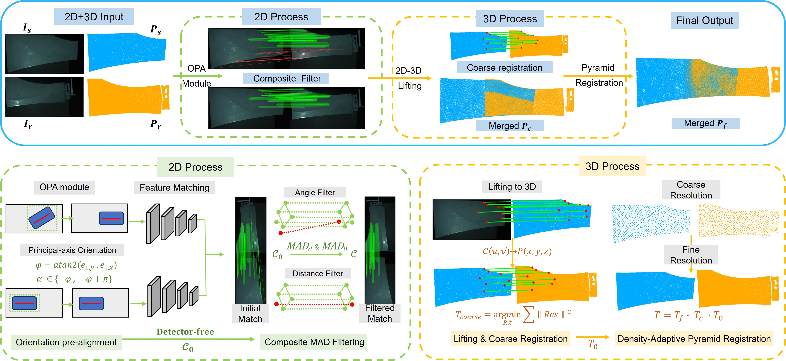
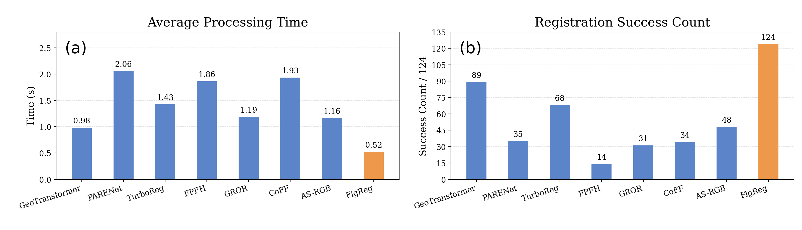

# FigReg

**Fast Image-Guided Point Cloud Registration for Weak-Feature Industrial Components**

Yuhan Pan, Liping Yang, Fuqiang Gou, Lina Fu, Siyu Chen, Hui Zhang, Yongqiang Li, Hong Huang

FigReg registers partially overlapping scans of industrial components with broad, smooth surfaces and repeated structures. It uses co-acquired images to establish reliable correspondences, followed by geometric refinement of the point clouds.

## Method

1. **Match in 2D:** Normalize image orientations using principal-axis pre-alignment, then generate correspondences with a pretrained detector-free matcher. Composite MAD filtering rejects inconsistent displacement directions and lengths.
2. **Estimate the 3D pose:** Lift the retained image matches through pixel-aligned XYZ maps and estimate a coarse rigid transformation with RANSAC.
3. **Refine efficiently:** Apply density-adaptive pyramid G-ICP from coarse to fine resolution to obtain the final alignment.

*Figure 1 from the manuscript. Click the image to view the full-resolution framework.*

## Results at a glance

*Figure 7 from the manuscript. FigReg achieves the highest success rate and lowest mean processing time among the eight evaluated methods.*

- **Reliable and fast:** 124/124 successful registrations across four industrial components, with a task-weighted mean runtime of **0.52 s per pair**.
- **Submillimeter alignment:** Mean translation error of **0.26–0.30 mm** at approximately 50% acquisition overlap; mean alignment RMSE of **0.38–0.44 mm** under approximately 45° and 90° in-plane rotations.
- **Robust to noise:** **100% success on 52 pairs** with Gaussian noise added to both images and 3D coordinates.
- **Efficient refinement:** **42–49% lower total runtime** than single-level G-ICP on the Door and Near rotational subsets, with similar accuracy.

Results are reported in the manuscript using an Intel Core i7-10750H CPU and an NVIDIA RTX 2060 GPU (6 GB). Runtime is measured from memory-resident inputs to the final transformation.

## Resources

Selected real-world measurement data and a runnable demo will be made publicly available after publication of the paper.

| Resource | Documentation |
| --- | --- |
| Environment setup | To be added |
| Data and preparation | To be added |
| Code and demo usage | To be added |
| Configuration | To be added |
