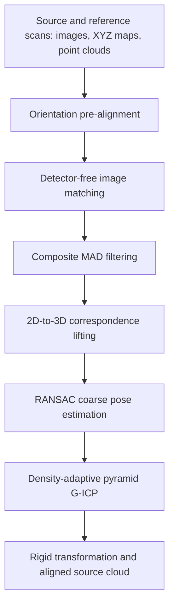

# FigReg

**Fast Image-Guided Point Cloud Registration for Weak-Feature Industrial Components**

Yuhan Pan, Liping Yang, Fuqiang Gou, Lina Fu, Siyu Chen, Hui Zhang, Yongqiang Li, Hong Huang

Companion repository for the FigReg manuscript, providing a method overview and reported experimental results. Selected real-world measurement data and a runnable demo will be made publicly available after publication of the paper.

## Release status

| Resource | Status |
| --- | --- |
| Method overview and experimental summary | Available below |
| Selected real-world measurement data | To be released after paper publication |
| Runnable demo for the sample data | To be released after paper publication |

Supported platforms, runtime requirements, input formats, and execution instructions will accompany the demo release.

## Overview

Registering scans of industrial components is challenging when broad, smooth surfaces offer few distinctive geometric features and repeated structures create ambiguous correspondences. FigReg uses the images acquired alongside structured-light point clouds to establish coarse correspondences, then refines the alignment geometrically.

The method combines principal-axis orientation pre-alignment, pretrained detector-free image matching, composite median absolute deviation (MAD) filtering, and density-adaptive pyramid generalized iterative closest point (G-ICP) refinement. Filtered image matches are lifted to metric 3D correspondences through pixel-aligned XYZ maps. No task-specific training of the image matcher or auxiliary pose information is required.

## Method

- **Orientation pre-alignment (OPA):** Extracts component regions from valid XYZ-map pixels and normalizes their dominant image orientations. Two source orientations resolve the 180-degree ambiguity of the principal axis when rotation normalization is needed.
- **Detector-free matching and composite MAD filtering:** The pretrained EDM matcher generates image correspondences. Circular angular consistency and direction-constrained displacement-length consistency suppress competing matches between repeated regions.
- **Metric lifting and coarse registration:** Image coordinates are mapped back to the original pixel grids and converted into 3D point pairs using the XYZ maps. RANSAC estimates the initial rigid transformation.
- **Density-adaptive refinement:** A two-level G-ICP schedule adapts voxel sizes to estimated point spacing, reducing residual misalignment at the coarse level before fine refinement.

## Inputs and outputs

Each source or reference scan supplies:

| Input | Description |
| --- | --- |
| Image | Fringe-free image of the measured component |
| XYZ map | Ordered metric XYZ coordinates aligned with the image pixels, with the same image dimensions |
| Point cloud | Unordered 3D points; the manuscript uses PLY files |

The output is a rigid transformation that maps the source cloud into the reference coordinate frame, together with the aligned source cloud. Pixel alignment between each image and its XYZ map provides the connection between image matches and measured 3D coordinates.

## Experimental results

The manuscript evaluates four industrial components: a door panel, a fender, a bumper beam, and a plate with a rectangular hole array (HT). Across **124 registration tasks**, FigReg achieves **100% registration recall** with a **task-weighted mean processing time of 0.52 s per pair**, the highest recall and lowest mean processing time among the eight evaluated methods.

### Translational motion

| Dataset | Pairs | Nominal acquisition overlap | Recall (%) | Mean RRE (deg) | Mean RTE (mm) | Mean time (s) |
| --- | ---: | ---: | ---: | ---: | ---: | ---: |
| Door | 30 | Approx. 50% | 100.00 | 0.04 | 0.30 | 0.51 |
| Door | 30 | Approx. 30% | 100.00 | 0.16 | 1.28 | 0.50 |
| Fender | 22 | Approx. 50% | 100.00 | 0.03 | 0.26 | 0.50 |

RRE and RTE denote relative rotation and translation errors against reference poses obtained from the linear actuator's displacement records. A translational registration is successful when **RTE < 5 mm** and **RRE < 1.50 degrees**.

### In-plane rotation

| Pairing | Pairs | Orientation change | Recall (%) | Mean RMSE (mm) | Mean overlap (%) | Mean time (s) |
| --- | ---: | ---: | ---: | ---: | ---: | ---: |
| Near | 21 | Approx. 45 degrees | 100.00 | 0.38 | 93.35 | 0.56 |
| Next | 21 | Approx. 90 degrees | 100.00 | 0.44 | 91.74 | 0.52 |

Each pairing includes 14 Bumper pairs and 7 HT pairs. Rotational registration is evaluated using bidirectional nearest-neighbor distances with a 2 mm inlier threshold; success requires **RMSE < 0.50 mm** and **overlap > 80%**. This post-registration overlap metric differs from the nominal acquisition overlap in the translational table.

### Additional findings

- **Combined image and 3D noise:** FigReg maintains 100% recall on 52 Door and Fender pairs with Gaussian image noise (standard deviation 5 on an 8-bit intensity scale) and 3D coordinate noise (standard deviation 0.05 mm), achieving a mean RTE of 0.39 mm.
- **Refinement efficiency:** Pyramid G-ICP reduces total runtime by approximately 42-49% relative to single-level refinement on the Door and Near rotational subsets, while maintaining similar alignment accuracy.
- **Transfer to RGB-D data:** On RGB-D Scenes v2 `scene_01` and `scene_02`, and 7-Scenes `heads`, reported recall ranges from 91.67% to 100%, with mean runtimes of approximately 359-396 ms per pair. These experiments use RTE < 30 mm and RRE < 1.50 degrees as the success criterion.

All results above are reported in the manuscript. Industrial experiments use an Intel Core i7-10750H CPU and an NVIDIA RTX 2060 GPU with 6 GB VRAM. Runtime measures processing from memory-resident inputs to the final transformation.

## Manuscript

**Title:** FigReg: Fast Image-Guided Point Cloud Registration for Weak-Feature Industrial Components

**Authors:** Yuhan Pan, Liping Yang, Fuqiang Gou, Lina Fu, Siyu Chen, Hui Zhang, Yongqiang Li, Hong Huang

The manuscript is being prepared for submission. A paper link and formal citation will be added when available.
